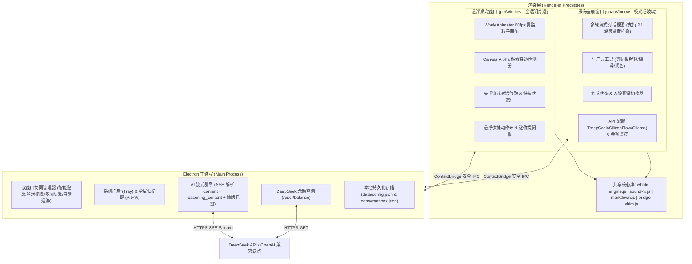

# DeepSeek 鲸鱼桌面宠物（DeepWhale）调研报告与项目开发计划

> **工作空间路径**：`D:\Note\Dev_note\Antigravity_deepseek_desktopApp_ws`  
> **项目代号**：`DeepWhale`（深海小鲸 · AI 动态交互桌宠）  
> **文档版本**：v1.0

---

## 一、 现有同类开源项目深度调研

围绕“**DeepSeek 鲸鱼形象桌宠**”与“**接入大模型 API 的动态交互桌面宠物**”两大核心方向，我们对当前 GitHub 及开源社区的代表性项目进行了系统性梳理，按生态定位与技术路线分为以下三类：

### 1.1 DeepSeek 鲸鱼主题桌宠生态项目

| 项目名称 | 技术栈 / 形态 | 核心亮点 | 局限性与可改进点 |
| :--- | :--- | :--- | :--- |
| **`keleus/deepseek-pet`** | Web / Live2D 风格矢量组件 | 专为 DeepSeek 设计的蓝鲸形象；**核心亮点是将 AI 会话状态（Idle、Thinking 深度思考、Tool Call、Error）与蓝鲸微表情和头顶气泡实时联动**。 | 依赖特定宿主插件环境（DSH），非独立原生系统级透明桌宠。 |
| **`Suiwan/whale-purse`** | 悬浮窗组件 + DeepSeek API | 除可拖拽蓝鲸悬浮交互外，集成了 **DeepSeek 官方 `/user/balance` 账户余额监控**、会话 Token 统计与开销提醒，兼顾陪伴与实用。 | 动画帧较为简单，缺少完整的自由对话舱与物理摆尾反馈。 |
| **`aceice01/dsh-whale-pet`** | Electron 透明小窗 + Web 悬浮层 | 采用**桌面独立透明置顶窗口**，支持多种撒娇/互动动作、语音合成播报（TTS）、任务提醒及余额徽章。 | 形象偏向二次元拟人（鲸鱼娘），而非纯粹的 DeepSeek 经典小蓝鲸本体形象。 |
| **`Sutera-Diffusus/dsh-whale-musume`** | Electron + 前端状态机 | 完善的**轻养成系统**（心情、好感度、投喂互动）与数百条程序员陪伴随机台词，工作状态感知细腻。 | 同样为拟人化立绘，且未内置独立的流式多轮 AI 对话面板。 |
| **`chenthreegold/deepseek-whale-pet`** | Python (`tkinter`) + Web 预览双端 | 提供了**桌面透明悬浮窗 + 浏览器直接预览**双模式，方便跨环境调试与展示。 | 像素帧动画分辨率受限，缺少现代毛玻璃对话 UI 与流式 Markdown 渲染。 |

### 1.2 主流通用开源 AI 桌宠框架

| 项目名称 | 技术栈 | 核心架构与借鉴价值 |
| :--- | :--- | :--- |
| **`ruguo0119/AI-Desktop-Pet`** | Electron + Web 前端 + Python | 成熟的 Electron 透明窗口方案，利用 `setIgnoreMouseEvents(true, { forward: true })` 实现**像素级鼠标穿透**；支持接入 DeepSeek 等多模型及情感标签驱动动作。 |
| **`ReSerendipity/SpiritPal` (桌边友)** | Tauri v2 + React + Canvas/WebGL | 主打**轻量情感陪伴 + 温和生产力辅助**（剪贴板快捷提问、长期人设记忆、不打扰的专注穿透模式）。 |
| **`ChaozhongLiu/DyberPet` (呆啵宠物)** | Python + PySide6 | 桌宠物理与状态机标杆：完整的**拖拽惯性、自由巡游（行走/游动）、摸头好感度、喂食动画与系统托盘控制**。 |
| **`Derpyu520/ottopet`** | Python + PyQt | 支持 **OpenAI 兼容接口 SSE 流式对话**、窗口跳跃/抖动物理反馈与合成音效系统。 |

---

### 1.3 调研总结：我们的差异化融合方案

综合上述项目的优势与痛点，我们的 **DeepWhale（深海小鲸）** 将取长补短，打造一个**开箱即用、原生丝滑、纯粹还原 DeepSeek 经典蓝鲸神韵**的桌面级 AI 伙伴：

1. **高还原度 60fps 骨骼流体小蓝鲸（告别僵硬贴图）**：
   - 采用 HTML5 HiDPI `<canvas>` **程序化脊椎物理与矢量渲染引擎**，复刻 DeepSeek 标志性的活力深海蓝（`#3B66FF` → `#0D28F3`）与冰白腹褶（Ventral Pleats）造型。
   - 实现**真实鼠标眼球追踪（Eye Tracking）**、**拖拽速度弹簧摆尾（Spring Physics）**、**双击头顶喷水柱 + 水珠气泡粒子**、**`deepseek-reasoner` 思考星环动画**等 9 种细腻状态。
2. **双窗口协同 + 像素级鼠标穿透（不挡桌面操作）**：
   - **悬浮桌宠主窗（`petWindow`）**：全透明无边框置顶，基于 Canvas Alpha 通道实时检测——鼠标在空白透明处完全穿透至系统桌面；移至鲸鱼身体或悬浮气泡上自动捕获交互，彻底解决传统桌宠“透明方块挡鼠标”的痛点。
   - **深海 AI 座舱（`chatWindow`）**：独立毛玻璃圆角窗口，可一键从鲸鱼身旁呼出或收起；即使关闭大面板，也可通过鲸鱼下方的**迷你快捷输入框 + 头顶对话气泡**完成轻量实时问答。
3. **深度适配 DeepSeek V3 / R1 双模型与生态能力**：
   - 原生支持 `deepseek-chat` (V3) 与 `deepseek-reasoner` (R1)，**实时流式解析并可视化折叠展示 `reasoning_content`（深度思考过程 + 思考耗时计时）**。
   - 内置 **AI 情绪动作指令协议**（AI 回复中的 `[happy]`、`[spout]`、`[shy]`、`[excited]` 等情绪标签会自动触发小鲸鱼做出喷水、害羞脸红、欢快拍鳍等同步动作）。
   - 吸收 `whale-purse` 精髓，内置 **DeepSeek 账户余额实时查询（`GET /user/balance`）**，同时兼容硅基流动（SiliconFlow）、Ollama 本地模型等任意 OpenAI 兼容接口；未配置 Key 时提供**零门槛本地智能陪伴演示模式**。
4. **轻养成 + 程序员生产力伴侣**：
   - 摸头互动、投喂“算力磷虾”、心情/活力/羁绊等级持久化、桌面自由巡游（自动沿任务栏上方左右畅游并平滑转向）。
   - 一键读取剪贴板（解释代码 / 中英互译 / 总结润色）、Web Audio 程序化鲸鸣水泡音效 + Web Speech TTS 语音朗读、系统托盘（Tray）与全局快捷键（`Alt + W`）。

---

## 二、 技术选型对比与决策

针对本机开发环境（Windows 系统，已就绪 `Node.js v24.15`、`npm 11.12`、`Python 3.14 + Pillow`），我们对三种主流桌面技术栈进行评估：

| 维度 | Electron + 原生模块化 ES6 + Canvas | Tauri v2 (Rust) | Python + PySide6 |
| :--- | :--- | :--- | :--- |
| **透明窗与像素穿透** | 原生支持 `transparent: true` + `setIgnoreMouseEvents(true, { forward: true })`，成熟稳定 | 需编写 Rust Win32 API 钩子处理穿透轮询 | 支持 `Qt.FramelessWindowHint`，但富文本流式气泡较繁琐 |
| **动画与现代 UI 表现力** | 极强（60fps HiDPI Canvas 流体骨骼 + CSS 毛玻璃 + 流式代码高亮） | 极强（WebView2） | 中等（自绘复杂渐变、粒子与 Markdown 成本较高） |
| **环境依赖与启动速度** | 仅需单一 `electron` 依赖，零繁琐打包编译即可直接运行，同时支持浏览器预览 | 本机未安装 Rust (`cargo`) 及 C++ Build Tools，编译耗时极长 | 需额外安装 PySide6 等大型二进制库 |

**最终决策**：采用 **Electron + 模块化 ES6 + 60fps Canvas 物理骨骼引擎 + Node.js 原生流式 AI 服务**，并附带零依赖 **Web 预览服务（`npm run web`）**，兼顾原生桌面置顶透明穿透体验与极简工程可维护性。

---

## 三、 系统架构设计

---

## 四、 核心模块与分阶段开发计划

### 阶段一：工程脚手架与品牌视觉资产生成
1. 初始化 `package.json`、目录规范与 `.gitignore`。
2. 编写 `scripts/generate-icons.py`，使用 Python Pillow 绘制高清抗锯齿 DeepSeek 小蓝鲸图标，生成应用图标 `assets/icon.png`、托盘图标 `assets/tray-icon.png` 与 Windows 图标 `assets/icon.ico`。

### 阶段二：主进程基础设施、持久化存储与 AI 流式服务
1. **`src/main/store.js`**：实现配置与会话本地 JSON 存储（保存在工作区 `data/` 目录），内置 4 套精选人设（元气深海小鲸、代码领航鲸、温柔治愈鲸、傲娇毒舌鲸）与宠物养成属性（心情、活力、好感度、等级）。
2. **`src/main/ai-service.js`**：
   - 基于原生 `fetch` + `ReadableStream` 实现零依赖高性能 SSE 流式解析器。
   - 同时提取 `delta.reasoning_content`（R1 思维链）与 `delta.content`（正文），支持 `AbortController` 随时中断生成。
   - 解析回复开头的 `[happy]` / `[spout]` / `[shy]` / `[think]` / `[excited]` / `[sleepy]` 情绪标签并广播给桌宠窗口触发实时动作。
   - 实现 API 连通性测试、DeepSeek `/user/balance` 余额查询，以及未配置 API Key 时的**本地智能流式陪伴回退模式**。
3. **`src/main/main.js` & `preload.js`**：
   - 构建全透明置顶 `petWindow` 与智能贴靠 `chatWindow`。
   - 实现无抖动屏幕坐标级窗口拖拽（规避 `-webkit-app-region: drag` 吞噬鼠标事件的通病）、桌面任务栏上方自由巡游物理循环、系统托盘菜单及全局热键 `Alt+W`。

### 阶段三：60fps DeepSeek 鲸鱼动画引擎与交互音效系统
1. **`src/renderer/shared/whale-engine.js`**：
   - 构建小蓝鲸流线型身体、上扬尾柄、双叶尾鳍（正弦波相位差摆动）、冰白腹褶、立体高光、前后胸鳍、喷水孔。
   - 实现 9 种核心动画状态：`idle`（呼吸悬浮）、`swimming`（巡游摆尾 + 平滑转身镜像）、`dragging`（惯性弹簧拉扯 + 惊讶表情）、`petting`（眯眼微笑 + 腮红 + 飘爱心）、`thinking`（歪头 + DeepSeek 神经网络星环）、`speaking`（张嘴韵律说话 + 音符水泡）、`spouting`（双弧线喷水柱 + 水雾粒子）、`eating`（投喂磷虾跃入口中 + 星光粒子）、`sleeping`（闭眼深呼吸 + Zzz 气泡）。
   - 提供 `isPointOpaque(x, y)` 像素 Alpha 采样方法供鼠标穿透调用。
2. **`src/renderer/shared/sound-fx.js`**：
   - 使用 Web Audio API 合成空灵鲸鸣（Whale Chirp）、水泡破裂声（Bubble Pop）、投喂清脆音与思考提示音；集成浏览器原生 `speechSynthesis` 中文语音播报（可自由开关）。

### 阶段四：桌宠主界面（`petWindow`）与深海 AI 座舱（`chatWindow`）开发
1. **桌宠端（`src/renderer/pet/`）**：
   - 头顶流式气泡（自动截断长文并支持一键展开完整对话窗）、鼠标悬停浮现半弧形快捷工具栏（对话、投喂、巡游、问剪贴板、睡眠、设置）、底部轻量快捷提问条。
   - 连续抚摸检测（快速划过鲸鱼背部触发摸头欢呼 + 好感度增加）、双击喷水柱彩蛋、闲置暖心台词轮播。
2. **对话与设置座舱（`src/renderer/chat/`）**：
   - 顶部状态栏：在线模型切换（`deepseek-chat` V3 / `deepseek-reasoner` R1）、实时余额徽章、置顶开关。
   - 聊天消息流：支持流式 Markdown 代码块一键复制、R1 深度思考折叠面板（带实时秒表）。
   - 多标签抽屉：💬 **实时对话** / 🌟 **小鲸养成与人设** / ⚙️ **API 与偏好设置**（内置 DeepSeek / SiliconFlow / Ollama 一键预设填充与连接测试）。

### 阶段五：双模预览服务、自动化冒烟测试与文档交付
1. 编写 `scripts/web-preview.js` 与 `bridge-shim.js`，支持在无桌面 GUI 沙箱或浏览器中完整运行所有功能。
2. 编写 `scripts/smoke-test.js` 对存储读写、AI 流式解析、情绪标签提取、静态资源与接口做端到端自动化验证；安装 Electron 并验证应用启动无误。
3. 输出详尽的 `README.md` 启动、配置与扩展指南。
